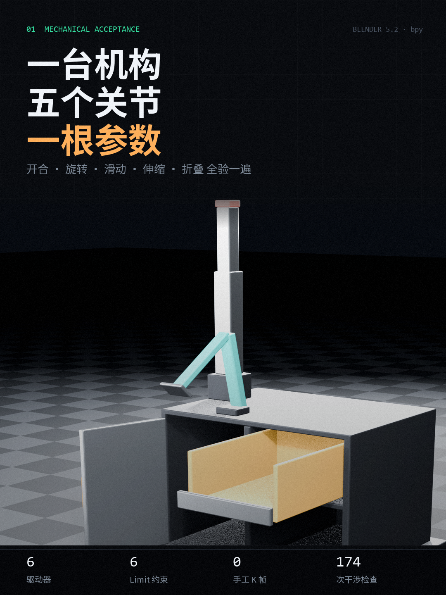

# mech-bench-demo

一台机械验收台的完整 **绑定 / 约束 / 驱动器 / 刚体** 演示，全部由 `bpy` 程序化生成。
没有手工建模，没有手工 K 帧，画面里每一个数字都是从 Blender 评估后的 depsgraph 读回来的。

Provisionally, a mechanical acceptance bench built entirely in `bpy`: one master
parameter drives five mechanisms, six Limit constraints clamp every joint inside
its declared travel, and a rigid-body drop test proves the collision proxies.
Every number on screen is read back from the evaluated scene, not authored.

| 竖屏 9:16 · 14 s | 3:4 封面 |
|---|---|
| [media/mech_bench_vertical.mp4](media/mech_bench_vertical.mp4) |  |

横版 16:9 同一条片子：[media/mech_bench_demo.mp4](media/mech_bench_demo.mp4)

---

## 它验什么

机柜上装五个机构，全部读同一个 `CTRL["deploy"]`：

| 机构 | 类型 / 轴 | 声明行程 | 驱动要的量 | 实测停在 |
|---|---|---|---|---|
| 铰链门 | revolute Z | 0 – 105° | 140° | 105° |
| 抽出托盘 | prismatic Y | 0 – 300 mm | 420 mm | 300 mm |
| 两级桅杆 | prismatic Z ×2 | 0 – 300 mm | 460 mm | 300 mm |
| 折叠臂 A | revolute X | −80 – 0° | 95° | 80° |
| 折叠臂 B | revolute X | 0 – 120° | 145° | 120° |

驱动故意越界 30–40%，**约束负责把它拦下**。所以片子里左右两列的量值不是文案，
是同一个关节「要多少」和「实际放行多少」的对比。

除此之外：

- **干涉检查** — 6 组配对（门 / 抽屉 / 折叠臂 vs 机架）在 174 个姿态上做 BVH 面相交，0 命中
- **刚体落体** — 0.6 kg 球落进抽出的托盘，0.4× 慢放，球底与盘面接触余量 2 mm，穿透 0.0 mm
- **参数化** — 场景里 6 个 driver 全指向同一个空物体的自定义属性，任何关节上都没有关键帧

## 数字是怎么来的

`measured_angle()` 不读 `rotation_euler`，而是取 `obj.evaluated_get(depsgraph)` 的
世界矩阵、乘上评估后父级矩阵的逆，再解欧拉角：

```python
ev = obj.evaluated_get(dg)
rel = ev.matrix_world.to_3x3()
if obj.parent is not None:
    rel = obj.parent.evaluated_get(dg).matrix_world.to_3x3().inverted() @ rel
return math.degrees(rel.to_euler("XYZ")[axis_index])
```

`Limit Rotation` 钳制的是**输出**，`rotation_euler` 上还留着驱动写进去的越界值。
读输出矩阵才能证明约束真的生效 —— 这一点决定了整套片子是「演示动画」还是「验收记录」。

## 结构

```
src/
  build_mech.py        建模 + 绑定 + 驱动器 + 约束 + 刚体 + 渲染（横版；--vertical 出竖屏）
  compose_mech.py      横版 HUD 合成，PIL 逐帧叠字 → ffmpeg 直出 H.264
  compose_mech_vert.py 竖屏 HUD 合成（1080×1920，读数改成两列网格压在画面下三分之一）
  gen_cover.py         从竖屏帧切一张 1080×1440 封面
```

场景里的机构层级：

```
PLINTH
└─ FRAME (机架)
   ├─ DOOR ──────────────── driver: rotation_euler.z   + Limit Rotation
   │  └─ DOOR_HANDLE
   ├─ DRAWER (托盘) ─────── driver: location.y          + Limit Location
   │  ├─ dwall_l / dwall_r / dwall_back
   │  └─ DRAWER_FACE
   ├─ MAST_FIXTURE
   │  └─ MAST_STAGE1 ────── driver: location.z          + Limit Location
   │     └─ MAST_STAGE2 ─── driver: location.z          + Limit Location
   │        └─ MAST_BEACON
   └─ BRACKET_MOUNT
      └─ BRACKET_LINK1 ──── driver: rotation_euler.x    + Limit Rotation
         └─ BRACKET_LINK2 ─ driver: rotation_euler.x    + Limit Rotation
            └─ BRACKET_PAD
```

## 跑一遍

需要 Blender 5.2（`--factory-startup` 不需要，脚本自己清空场景）和一个带
`numpy / pillow / imageio-ffmpeg` 的 Python 3.12+。

```bash
# 1. 建模 + 约束 + 刚体 + 渲染帧（横版 110 帧 + 落体段 60 帧）
blender -b -P src/build_mech.py
# 竖屏：多一个开关，场景和绑定完全一样，只换相机和分辨率
blender -b -P src/build_mech.py -- --vertical

# 2. 合成
python src/compose_mech.py
python src/compose_mech_vert.py
python src/gen_cover.py      # 封面，顺手
```

默认输出到 `D:\mech_demo`（竖屏到 `D:\mech_demo\vert`）。换盘符：

```bash
MECH_OUT=/path/to/output blender -b -P src/build_mech.py
MECH_OUT=/path/to/output python src/compose_mech.py
```

调试用的开关：`--quick` 只渲一帧看构图，`--no-render` 只算数据不出图。

## 踩过的坑

写下来是因为每一条都静默失败，没有报错：

1. **`Limit Rotation` 挂在无父级的对象上不生效**（Blender 5.2）。有父级才会钳制，
   `Limit Location` 则没有这个问题。所以门、抽屉都得挂到机架节点下。
2. **`Limit Location` 把非驱动轴的 min/max 都设成 0，会把对象原有坐标削平** ——
   等于静默瞬移。抽屉被挪走、球砸空，查了半天。
3. **driver 是替换不是叠加**。`location.z` 一旦被 driver 接管，对象原本的
   z 偏移就归零，伸缩段会脱离机柜。正确做法是把偏移烘进几何、原点留在基座。
4. **父子关系别用 `obj.parent = p` 再赋世界坐标**，偏移会沿着链翻倍。要么显式算
   局部坐标，要么设 `matrix_parent_inverse`。
5. **刚体球用 BOX 代理会浮起或陷入约 10 mm**。托盘是带倒角的凸面，换
   `CONVEX_HULL` + margin 0.002 才贴面。
6. **EEVEE 首帧卡 6 分钟是着色器编译**，之后 0.3 s/帧。别以为是渲染慢去砍分辨率。

## 技术栈

Blender 5.2 · EEVEE · bpy / bmesh · 驱动器（scripted expression + single property）·
Limit Rotation / Limit Location 约束 · Bullet 刚体（`use_split_impulse`，`time_scale=0.4`）·
BVHTree 干涉检测 · PIL 逐帧 HUD · ffmpeg（libx264 / CRF 18）

---

MIT License
